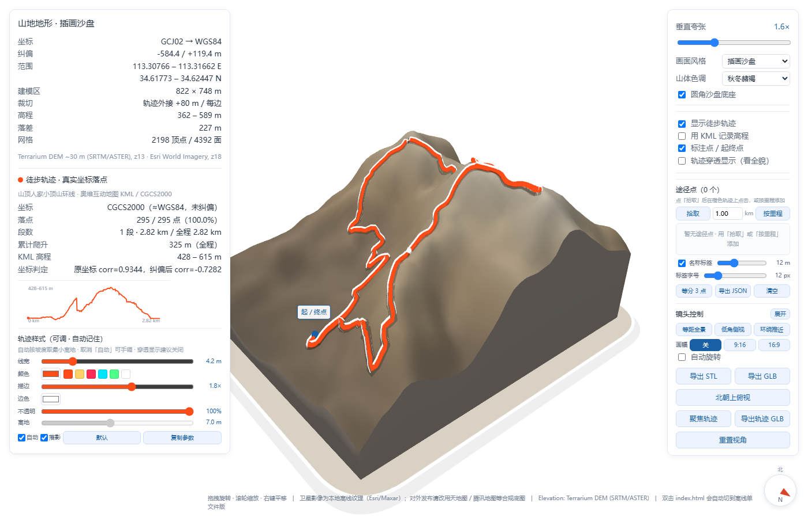
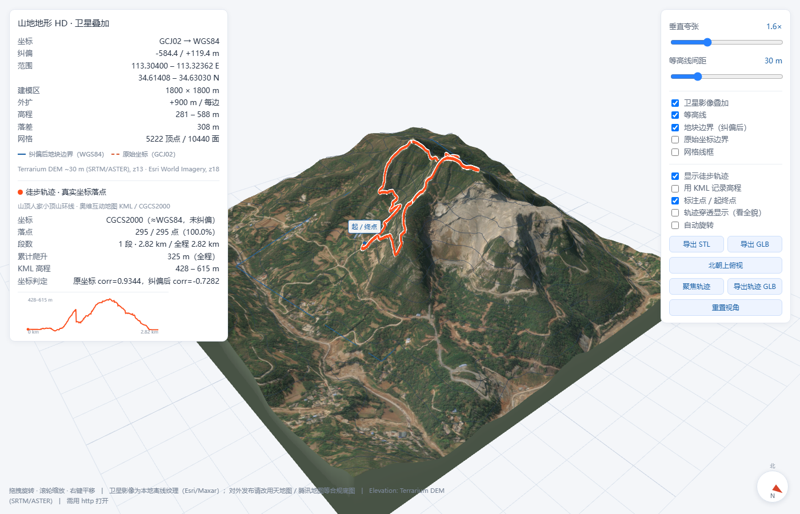

# 山地 3D 沙盘 · 轨迹叠加（terrain-track-3d）

给一条 GPS 轨迹（KML），自动生成一片**真实坐标**的山地 3D 沙盘，并把轨迹贴地叠上去。
输出可交互网页（three.js）、可双击打开的离线单文件、STL/GLB 模型，以及逐帧渲染的竖屏 MP4。

| 插画沙盘模式 | 卫星影像模式 |
|---|---|
|  |  |

> 示例区域：新密小顶山环线（奥维 KML，295 点，CGCS2000）。窗口 822×748 m，Terrarium DEM z13，Esri 影像 z18。

## 它做什么

1. **在线拉取** Terrarium DEM（z13 ≈ 30 m 精度）与卫星影像瓦片
2. 按轨迹外接框（三种口径可调）裁出建模窗口，生成**水密**地形网格（`non_manifold=0`）+ 薄底座
3. 轨迹按真实 WGS84 坐标**贴地叠加**：按地形实际三角剖分插值 + 自适应离地 + 贴地假投影
4. 输出可交互页面：轨迹样式调节、途径点、镜头关键帧分镜、播放预览、9:16 / 16:9 **真裁切**取景框
   - **途径点**：屏幕空间吸附拾取（不用精确点中那根 4 m 细管）、单点显示/隐藏、按里程等分、导出 GeoJSON
   - **地名标签字号**：基准 34 px（1080p 画布），只有相机推近到「放大距离」以内才放大、只放最近的 1 个，
     最高 3×；标签压到画面/面板边缘就整条隐藏，不再露半截。「小窗」按钮按成片占比（100/50/40/33%）预览，
     直接判断缩进剪映小窗后还能不能读
   - **时长 / 生长速度**：总时长 0.2–600 s，生长速度 0.5×–4× + 「铺满」，一行档位随手切
5. **8 个运镜模板**：途径点巡礼（沿轨迹连续前进、依次路过各点）/ 沿线跟拍 / 环绕展示 / 高程跟随 /
   俯冲进场 / 拉升退场 / 俯视平面 / 单点环绕；点一下自动算机位写入分镜表，换区域不用改数字。
   **所有模板的结尾都会拉回「3D 模型全览」并定格**，不会被画幅边框裁到
6. **网页直出 MP4**：面板顶部一键导出（24/30/60 fps、720p–4K），WebCodecs 硬编码，10 s 1080p60 约 4 s，不跑 Node/ffmpeg
7. 可选：CDP 逐帧渲染 + ffmpeg 合成（4K 长片 / 无人值守批量 / 断点续渲）

## 目录结构

```
skill/SKILL.md          WorkBuddy 技能定义（标准流程、必问的建模范围、踩坑清单）
MAKING_RULES.md         完整制作手册：数值依据、49 条踩坑表、换区域改行对照、验收 9 步
bootstrap_bbox.py       新区域引导：只从 KML 算外接框，写占位 track.json（解启动死循环）
build.py                建地形（DEM + 卫星 + 网格 + 底座 + 页面）
track.py                贴轨迹 + 注入页面 + 调用单文件打包
video.py                生成无 UI 的逐帧渲染页
render_frames.mjs       CDP 逐帧渲染 + ffmpeg 合成 MP4（断点续渲）
make_standalone.py      打包 file:// 可直接打开的单文件版
index.template.html     页面模板（插画沙盘 / 卫星 / 色板 / 控制面板）
_*_check.mjs            页面自检（CDP 无头 Edge）：镜头模板距离、导出、面板、播放、标签字号联动
vendor/                 three.js r187 + OrbitControls / STLExporter / GLTFExporter / mp4-muxer（网页封装 MP4）
docs/                   截图
```

## 依赖

- Python 3.9+，`pip install Pillow`（见 requirements.txt）
- Node 18+（仅渲染视频时需要）
- 网络：DEM 与卫星瓦片在线拉取，离线建不了
- ffmpeg（仅合成 MP4 时需要）

## 快速开始

```bash
git clone https://github.com/YangPhYY/terrain-track-3d.git
cd terrain-track-3d

# 1) 只给轨迹 KML 就能开工：算外接框，写占位 track.json
python3 bootstrap_bbox.py --kml "你的轨迹.kml"

# 2) 先干跑看窗口（不联网、不写文件），确认尺寸和轨迹覆盖率
python3 build.py --dry-run

# 3) 正式建模（自用/剪辑走 Esri，清晰度最高）
python3 build.py --sat=esri --z-sat=18

# 4) 贴轨迹 + 生成页面（--kml 指向你的轨迹）
python3 track.py --kml "你的轨迹.kml"

# 5) 本地预览
python3 -m http.server 8766 --directory .
# 浏览器打开 http://127.0.0.1:8766/index.html
```

> ⚠️ 直接双击 `index.html`（file://）会一直「正在加载」——浏览器拦截 ES module。
> 请走 http 服务，或用 `index_standalone.html` 单文件版（`track.py` 会自动生成）。

### 三种窗口口径

轨迹常常只是**路过**一座山，按轨迹裁会把山切掉一半。先想好再建：

| 口径 | 参数 | 适用 |
|---|---|---|
| 贴轨迹裁（默认） | `--box=auto --buffer=80` | 轨迹就是主角，主体最大 |
| 包住整座山 | `--buffer=250`（150–400 可调） | 轨迹只走一条沟 / 一段山脊 |
| 按区域轮廓 | `--box=geo`（需 GeoJSON） | 保住整块地，轨迹偏在一侧 |
| 手填矩形 | `--box=minlon,minlat,maxlon,maxlat` | 山顶范围 / 人工微调 |

### 生成视频

**首选网页直出**：页面右侧面板顶部「⬇ 导出 MP4」，选帧率与清晰度点一下即可。
纯浏览器内 WebCodecs(H.264) + `mp4-muxer`，尺寸跟画幅走（16:9→1920×1080、9:16→1080×1920），
构图与预览逐像素一致，10 s 1080p60 约 4 秒出片。

需要 4K 长片、无人值守批量或断点续渲时，才走命令行链路：

```bash
python3 video.py                                   # 生成无 UI 渲染页
node render_frames.mjs "" 1080 1920 30 12          # 1080 竖屏 12 秒
FRAME_LIST=0,72,144,204,239 node render_frames.mjs # 先出 5 帧验构图再全量
```

页面上调好的镜头点「复制参数」，把串放进 `track_style.json` 或 `TRACK_STYLE` 环境变量即可复用。

### 画幅与运镜

- 画幅切 9:16 / 16:9 是**真裁切**：`camera.aspect` 与渲染视口同步收到框内，框里看到的就是成片；
  切画幅会自动把中远景机位与分镜按新比例重算，竖屏不会左右出框。
- 运镜模板的距离由 `fitR()` 按模型对角线 + 当前画幅二分求出；环绕类用 `orbitR()` 取整圈最大距离，
  保证转到任意方位都不裁角。
- 全览取景用 `overviewR()`：8 个角点 + 所有地名标签锚点一起装进画面（留 10% 边），所以定格时模型完整、标签也不会被框线切。
- 载入分镜 / 切画幅时 `normOverview()` 会按当前画幅补足全局机位的距离（只加不减），
  16:9 调好的分镜直接拿到 9:16 也不会左右出框。

## 需要改的路径

脚本用自身位置定位工程目录（可用 `TERRAIN_HOME` 环境变量覆盖），只有输入文件要自己指：

- `bootstrap_bbox.py --kml=...` / `track.py --kml=...`：轨迹 KML
- `build.py --geo=...`（可选）：区域轮廓 GeoJSON，只用来画边界线，**不给也能建**
- `build.py --sat=tianditu` 时需要天地图 tk（自用剪辑不需要）

## 坐标系说明（最容易踩的坑）

| 来源 | 坐标系 | 处理 |
|---|---|---|
| 两步路 KML `gx:Track` | WGS84 | 原样使用，不要纠偏 |
| 奥维 KML `LineString` | CGCS2000（≈WGS84） | 基本等同，不纠偏 |
| DataV / 高德 / 腾讯系 GeoJSON | GCJ02（火星坐标） | 必须 `gcj2wgs()` |

判定方法：把 KML 点打在地形上看 KML 高程与 DEM 高程的相关性——未纠偏应为正（本区域 0.93），
纠错了会是负值（本区域 −0.73）且 RMSE 破百米。

其余 45+ 条踩坑（网格索引错位 249 m、双线性插值穿山 20 m、轴向镜像、网页导出假死、竖屏取景出框、
标签字号在小窗里看不见、面板 `display:none` 导致成片标签全消失……）
见 [`MAKING_RULES.md`](MAKING_RULES.md) 第 9 节。

## 装成 WorkBuddy 技能

把 `skill/SKILL.md` + `MAKING_RULES.md` + `bootstrap_bbox.py` 复制到
`~/.workbuddy/skills/terrain-track-3d/`，之后说「做另一个区域的 3D 模型」即可自动按流程执行
（会先弹窗问建模范围，再 `--dry-run` 给数字确认）。

## License

[MIT](LICENSE)
